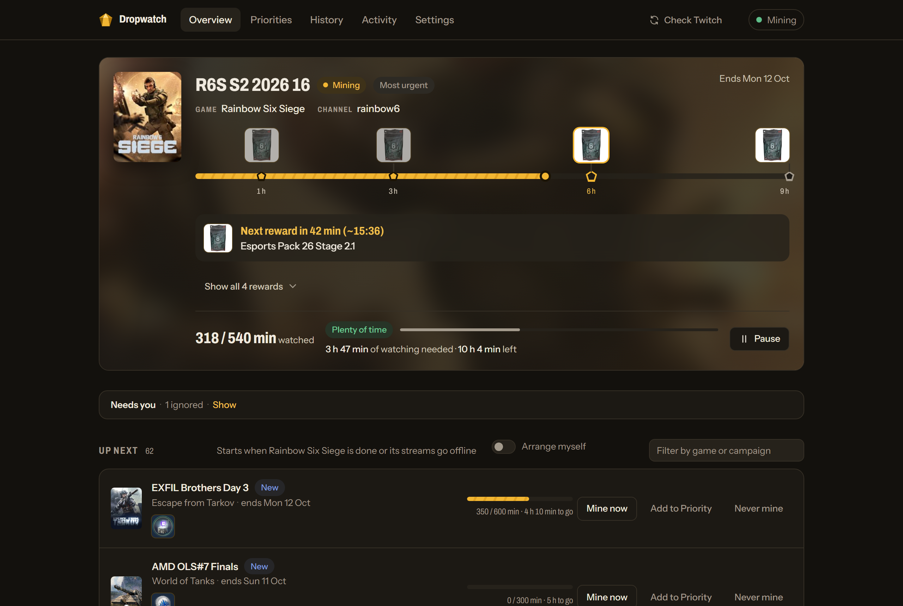
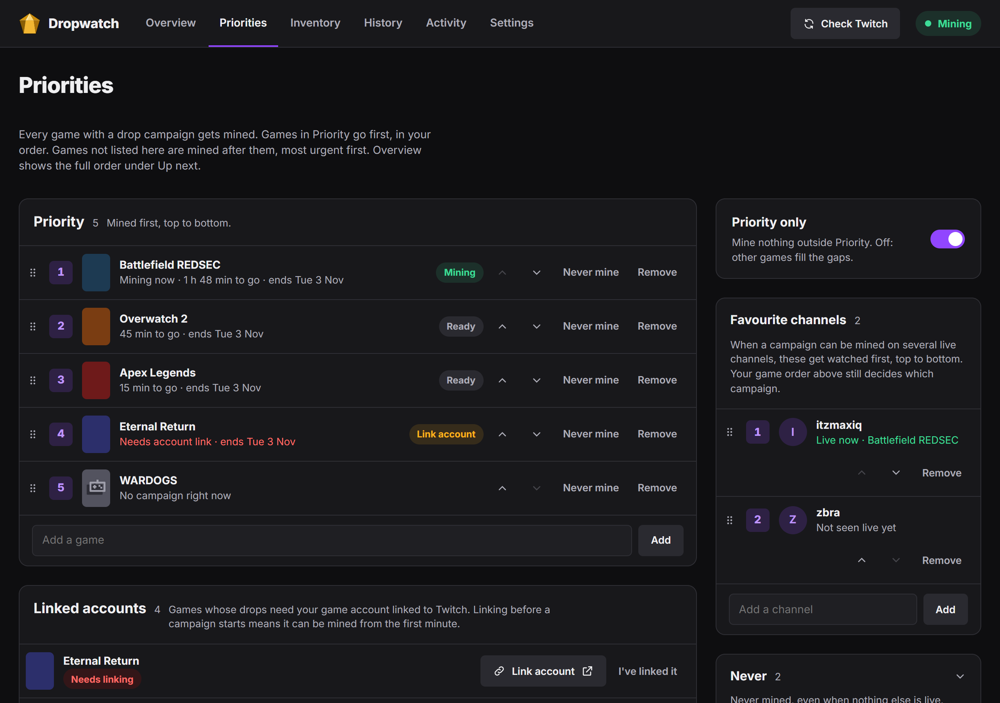
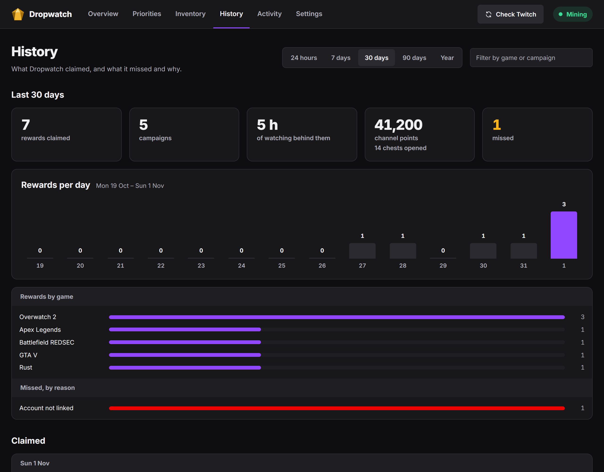
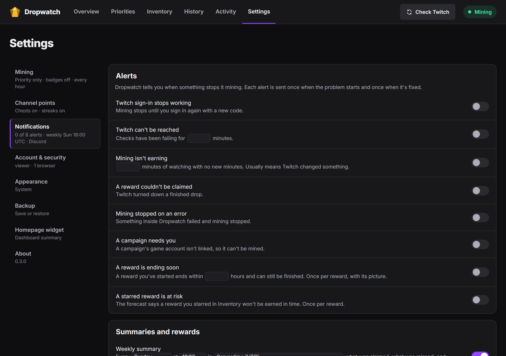
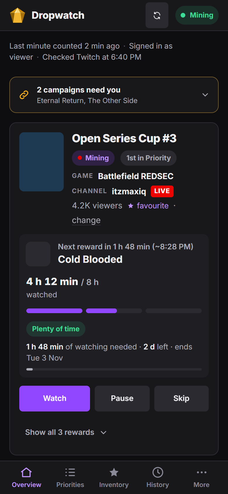

<picture>
  <source media="(prefers-color-scheme: dark)" srcset="brand/lockup/dropwatch-lockup-dark.svg">
  
</picture>

Dropwatch earns Twitch Drops for you in the background. It picks which campaign to watch, moves to another
channel when a stream goes offline, and claims each reward as soon as it's earned. It also collects channel
points and watch-streak bonuses on your favourite channels. A web dashboard shows what's being mined, what's
next, and anything that needs you.

It runs as a single Docker container, made for Unraid but fine on any Docker host.



## What it does

- **Mines the right campaign.** Every game with a drop campaign gets mined. Games you put in Priority go
  first, in your order; the rest are mined most urgent first. You can also pin campaigns to go next, or
  mark a game Never.
- **Claims rewards for you,** as soon as Twitch counts them as earned.
- **Channel points.** Opens bonus chests on the channel being watched (and any left waiting on channels
  watched in the last week), and visits favourite channels briefly to keep their watch streaks going.
- **Tells you what needs you.** Campaigns that need a game account linked are listed with a link to do it.
  Ignore one you don't care about and it stays quiet until it ends.
- **History.** What was claimed, what was missed and why, and how many channel points were earned.
- **Notifications** to Discord, Telegram, ntfy, Slack, Pushover, Gotify or any webhook: when mining stops
  or isn't earning, when a claim fails, a weekly summary, and (optionally) every reward claimed.
- **Works on a phone.** The dashboard is built for small screens too.

| Priorities | History |
|---|---|
|  |  |

| Settings | On a phone |
|---|---|
|  |  |

## Install on Unraid

Until Dropwatch is listed in Community Applications, add its template by hand once:

1. Open the Unraid terminal (the `>_` icon at the top right) and run:

   ```
   wget -O /boot/config/plugins/dockerMan/templates-user/my-dropwatch.xml https://raw.githubusercontent.com/KernelPanic-Studios/dropwatch/main/unraid/dropwatch.xml
   ```

2. Go to **Docker**, then **Add Container**, and pick **dropwatch** from the **Template** list.
3. Check the data path (default `/mnt/user/appdata/dropwatch`) and port (default `5800`), then **Apply**.
4. Open the WebUI and follow the two first-run steps below.

Updates show up on the Docker tab like any other container's.

## Install with Docker

```
docker run -d --name dropwatch --restart unless-stopped \
  -p 5800:5800 -v /path/to/dropwatch:/data \
  -e TZ=America/New_York \
  --log-opt max-size=10m --log-opt max-file=3 \
  ghcr.io/kernelpanic-studios/dropwatch:latest
```

`--restart unless-stopped` matters: if mining ever gets stuck, Dropwatch exits on purpose so Docker can
start a fresh one. See [docs/docker.md](docs/docker.md) for every setting, the health check and building
the image yourself.

## First run

1. **Page password.** The first visit asks you to choose a password for the dashboard. It's separate from
   your Twitch password; anyone on your network who opens the page needs it.
2. **Twitch account.** Dropwatch shows a one-time code. Enter it at
   [twitch.tv/activate](https://www.twitch.tv/activate) on any device (there's a QR code for your phone)
   and sign in to Twitch as usual. Mining starts straight away.

One Twitch account per container. Don't run another drops miner on the same account at the same time.

## Settings worth knowing

| Setting | Default | What it's for |
|---|---|---|
| Data path (`/data`) | `/mnt/user/appdata/dropwatch` | The database (sign-in, lists, history) and cached images. Back it up with the rest of appdata, or use **Settings › Backup** in the app. |
| Web UI port | `5800` | The dashboard. |
| `DROPWATCH_HOSTS` | empty | Only needed if you open Dropwatch through a public domain name, such as a reverse proxy. IP addresses and local names like `tower` or `tower.local` always work. |
| `FORWARDED_ALLOW_IPS` | empty | Behind a reverse proxy: its address, so the login lockout sees each visitor's own address. |
| `PUID` / `PGID` | `99` / `100` | The user the miner runs as (Unraid's nobody:users). |

## Good to know

- **Twitch's rules.** Watching streams automatically to earn drops isn't something Twitch's terms of
  service allow. Tools like this have been around for years, but use it on your own account at your own
  risk.
- **When Twitch changes something,** mining can stop until Dropwatch is updated. The "isn't earning" and
  "stopped" notifications are there so you find out quickly; updates arrive as a new image.
- **Linking game accounts** is still up to you: some campaigns only pay out once your game account is
  connected to Twitch. Dropwatch lists those under Needs you.

## Support

Questions and bug reports: [GitHub issues](https://github.com/KernelPanic-Studios/dropwatch/issues).

## Credits and license

Dropwatch's Twitch protocol handling is ported from the MIT-licensed
[TwitchDropsMiner](https://github.com/DevilXD/TwitchDropsMiner) by DevilXD and two of its forks; see
[NOTICE](NOTICE). Dropwatch itself is released under the [MIT License](LICENSE).

Building it yourself, running the tests and the design notes: [docs/development.md](docs/development.md).
